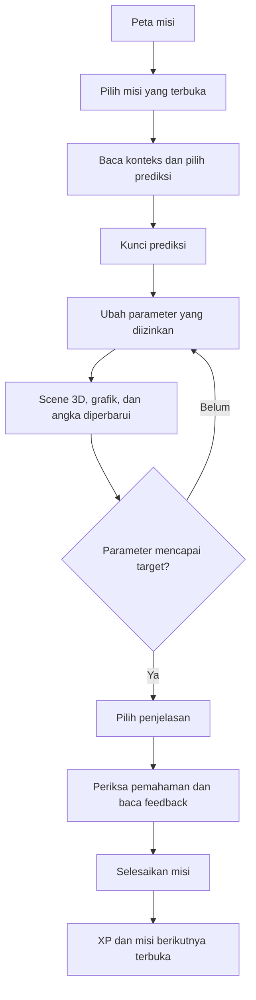
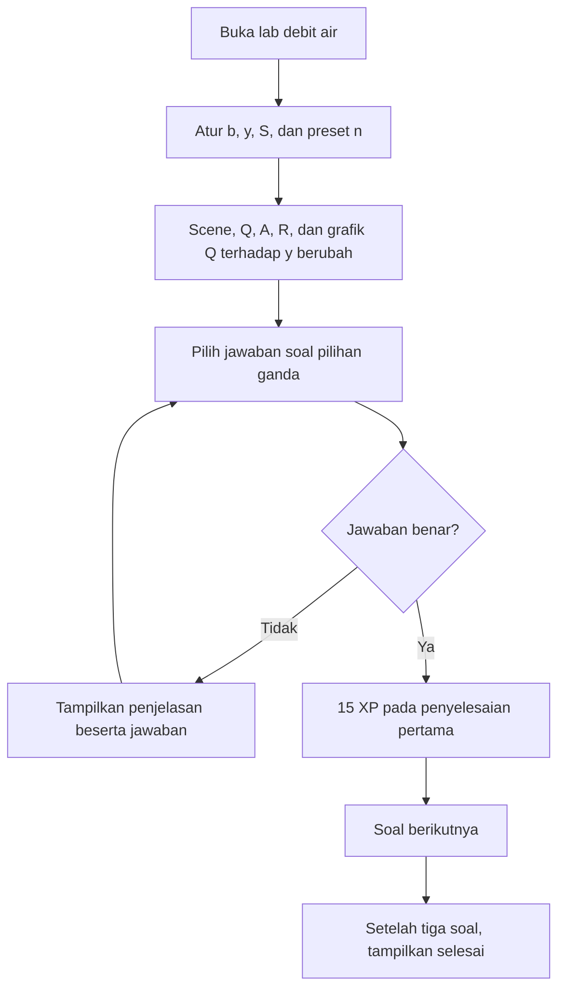
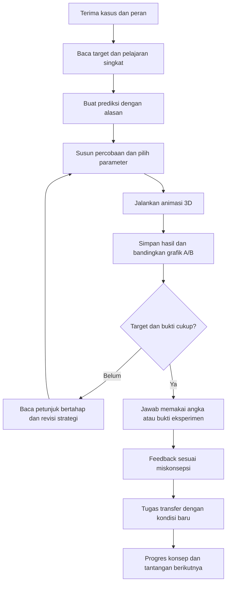

# Analisis Beam Lab V3 — workflow, materi, gamifikasi, dan animasi 3D

Tanggal audit: **15 Oktober 2026**. Status: **pencatatan awal sebelum pengembangan berikutnya**.

Catatan: dokumen ini merekam kondisi sebelum perbaikan. Implementasi dan hasil pemeriksaan sesudah redesign dicatat di [PERBAIKAN_BEAM_LAB_V3.md](PERBAIKAN_BEAM_LAB_V3.md). Nomor baris bukti di bawah merujuk snapshot awal audit.

Website yang ditinjau: [Beam Lab V3](https://beam-lab-one.vercel.app/v3.0/index.html).

## 1. Pemahaman tentang proyek KP

Beam Lab adalah prototipe media pembelajaran Teknik Sipil berbasis eksperimen dan misi. Tujuan produknya adalah membantu mahasiswa menghubungkan **kejadian di dunia nyata → variabel dalam rumus → perubahan objek → grafik → alasan ilmiah**.

Kebutuhan yang sudah berkembang dari percakapan proyek:

1. Rumus dapat dieksplorasi dengan mengganti angka dan melihat perubahan grafik.
2. Perubahan mempunyai representasi dunia nyata, awalnya lewat jembatan dan kendaraan 2D.
3. Materi diperluas ke debit air dan saluran terbuka.
4. V3 menghadirkan objek dan animasi 3D agar kejadian lebih mudah dibayangkan.
5. Mahasiswa memperoleh tantangan, kesempatan bereksperimen, dan progres belajar yang menarik.

Perkembangan versi yang tercatat di workspace:

| Versi | Fokus |
| --- | --- |
| 1.0 | Balok dengan beban merata, grafik lendutan, dan misi dasar. |
| 2.0 | Jembatan dengan beban titik kendaraan dan ilustrasi 2D. |
| 2.5 | Jembatan, debit Manning, dan tiga soal hidraulika. |
| 3.0 | Materi V2.5 dengan scene WebGL untuk jembatan dan saluran air. |

**Penilaian produk saat ini:** fondasi simulator dan urutan belajar sudah tersedia. Interaksi belajarnya masih banyak berupa mengikuti instruksi dan memilih jawaban. Hubungan antara tantangan, tindakan di scene, hasil eksperimen, dan penilaian belum cukup kuat untuk menghasilkan pengalaman permainan yang memuaskan.

Dasar pemahaman: [README](README.md), [workflow proyek](WORKFLOW.md), [catatan V3](v3.0/README.md), kode, dan penelusuran browser.

## 2. Cara pemeriksaan dan batas kesimpulan

- Meninjau website publik dan membandingkan file pentingnya dengan workspace. `v3.0/index.html`, `app.js`, `scene3d.js`, `styles.css`, serta stylesheet root identik pada saat audit.
- Menelusuri UI publik pada lebar 735 px dan salinan lokal pada lebar 1280 px. Percobaan jawaban dilakukan pada origin lokal terpisah agar jawaban dan XP di website publik tidak terganti.
- Menyelesaikan misi jembatan pertama dengan prediksi/refleksi keliru; memeriksa fitur ulangi; menyelesaikan tiga soal hidraulika; memeriksa orbit kamera dan feedback.
- Membaca definisi seluruh lima misi, perhitungan, aturan penilaian, penyimpanan, dan renderer. Misi jembatan 2–5 diperiksa melalui kode dan perhitungan; belum seluruhnya dimainkan dari awal sampai akhir di UI.
- Menjalankan perhitungan terisolasi dari fungsi aplikasi untuk memeriksa rasio bentang, respons beban, debit, urutan kunci jawaban, dan sembilan kombinasi desain. Tidak menambahkan file tes atau mengubah aplikasi.
- Menggunakan graphify untuk memetakan V3. Peta mencakup 12 file dan menghasilkan 128 node/254 edge. CSS/VERSION tidak tercakup; hubungan global `window.BeamLab3D` belum tersambung otomatis oleh AST. Ada satu pasangan relasi timbal balik yang menyatu dalam representasi graph tanpa arah; rinciannya tercatat di laporan graph. Temuan audit utama diperiksa langsung di kode/UI.
- Tidak melakukan uji pengguna mahasiswa, pengukuran FPS/baterai, pengujian semua perangkat, atau validasi kurikulum bersama dosen. Penilaian “kurang playable” adalah analisis desain yang perlu dikonfirmasi lewat uji pengguna.

Label bukti dalam laporan:

- **UI + kode:** perilaku diamati di browser dan penyebab ditemukan di kode.
- **Kode + hitung:** aturan/perhitungan diperiksa langsung, belum semua skenarionya dimainkan di UI.
- **Evaluasi desain:** penilaian pengalaman belajar atau visual, bukan laporan aplikasi crash.
- **Risiko teknis:** potensi masalah dari implementasi yang belum diukur/reproduksi pada perangkat sasaran.

## 3. Workflow aplikasi yang berjalan sekarang

### 3.1 Peta misi dan progres

Mahasiswa masuk ke peta misi. Lima misi jembatan terbuka berurutan. Debit air dapat dibuka langsung dari navigasi atau kartu hidraulika, tanpa menyelesaikan jalur jembatan.

Progres keseluruhan menghitung **5 misi jembatan + 3 soal debit = 8 konsep**. XP, jawaban, parameter, dan penyelesaian disimpan di `localStorage` dengan kunci `beamlab-progress-v3`. Penyimpanan ini hanya berlaku pada browser/origin yang dipakai, sesuai lingkup prototipe saat ini.

### 3.2 Jalur jembatan



| Misi | Tindakan utama | Konsep |
| --- | --- | --- |
| 01 Kendaraan melintas | Ubah muatan 20 → 30 ton. | Lendutan sebanding dengan beban titik. |
| 02 Material yang berbeda | Ganti baja → beton. | Pengaruh modulus elastisitas E. |
| 03 Bentuk penampang | Ganti persegi solid → profil I. | Pengaruh momen inersia I. |
| 04 Bentang lebih panjang | Ubah 8 → 9,6 m. | Pengaruh L³ untuk beban titik di tengah. |
| 05 Rancang dalam batas | Pilih material dan profil. | Lendutan ≤ 20 mm, biaya ≤ 110 kredit. |

Aturan aktual: prediksi salah tetap dapat melanjutkan eksperimen; refleksi salah juga dapat menyelesaikan misi. Hadiah misi = 20 XP dasar + 10 jika prediksi tepat + 20 jika refleksi tepat. Maksimum satu misi 50 XP.

### 3.3 Jalur debit air



Urutan soalnya adalah luas basah, pengaruh kedalaman terhadap debit, dan pengaruh kekasaran Manning. Jawaban dinilai berdasarkan ID pilihan yang tetap. Sistem tidak mensyaratkan mahasiswa melakukan eksperimen pada scene sebelum menjawab.

### 3.4 Hubungan antarbagian aplikasi

- [index.html](v3.0/index.html) memuat stylesheet root, stylesheet V3, renderer, dan aplikasi.
- [app.js](v3.0/app.js) menggabungkan isi misi, soal, state, hitungan, pembuatan UI, grafik, dan handler interaksi.
- [scene3d.js](v3.0/scene3d.js) membuat geometri, kamera, pencahayaan, dan animasi melalui WebGL langsung.
- `app.js` mengirim parameter lewat `window.BeamLab3D`. Renderer menghitung ulang sebagian rumusnya sendiri, sehingga nilai grafik dan representasi 3D belum berasal dari satu hasil perhitungan bersama.
- Geometri 3D dibangun dari kotak, bidang/ribbon, segmen, dan bola. Aset SVG dipakai untuk pilihan material/profil; keberadaan aset SVG tidak berarti scene menggunakan model 3D dengan tekstur/material realistis.

## 4. Ringkasan temuan dan prioritas

P0 = ketepatan materi harus dibenahi sebelum digunakan sebagai acuan belajar. P1 = mengganggu tujuan inti belajar/bermain. P2 = perbaikan pengalaman dan kejelasan. P3 = penguatan teknis yang perlu pembuktian lebih lanjut.

| ID | Prioritas | Temuan | Bukti |
| --- | --- | --- | --- |
| A01 | P0 | Misi bentang tidak menyediakan jawaban prediksi yang benar. | Kode + hitung |
| A02 | P1 | Animasi lendutan sudah mentok pada beban awal misi pertama. | UI + kode + hitung |
| A03 | P1 | Refleksi salah tetap mendapat status “Konsep dikuasai”. | UI + kode |
| A04 | P1 | Semua 13 kunci pilihan ganda ada di posisi pertama. | Kode + hitung |
| A05 | P1 | Soal debit tidak mengikuti kondisi simulasi; eksperimen tidak menjadi syarat. | UI + kode |
| A06 | P1 | Fitur ulangi membuka hasil lama, belum membuat percobaan baru. | UI + kode |
| A07 | P1 | Eksperimen awal meminta target yang sudah diberitahukan; keputusan mahasiswa terbatas. | Evaluasi desain |
| A08 | P2 | Petunjuk salah pada debit langsung memberikan jawaban lengkap. | UI + kode |
| A09 | P2 | Bentuk lendutan 3D berbeda dari kurva analitis grafik. | Kode + hitung |
| A10 | P2 | Muatan, kendaraan, material, dan profil belum dijelaskan lewat aksi visual yang kuat. | UI + kode/desain |
| A11 | P2 | Visual saluran otomatis meninggikan dinding saat kedalaman berubah. | Kode + evaluasi desain |
| A12 | P2 | Skala dan gerak air bersifat ilustratif tanpa pembacaan dimensi/kecepatan yang jelas. | UI + kode/desain |
| A13 | P2 | Scene/kamera dibuat ulang ketika panel jawaban berubah. | UI + kode |
| A14 | P2 | Grafik debit menyesuaikan skala sehingga perbandingan kondisi kurang jelas. | Kode + evaluasi desain |
| A15 | P2 | Materi belum mempunyai penjelasan bertahap, capaian, dan variasi tugas yang cukup. | UI + kode/desain |
| A16 | P2 | Tipografi kecil dan susunan layar sempit memisahkan kontrol dari objek/grafik. | UI + CSS |
| A17 | P2 | Navigasi/reset progres belum mendukung pemulihan interaksi dengan baik. | Kode; sebagian UI |
| A18 | P3 | Rumus terduplikasi dan loop renderer perlu penguatan sebelum perluasan. | Kode; risiko teknis |

## 5. Rincian kesalahan terverifikasi

### A01 — Prediksi misi bentang salah

**Lokasi:** [definisi misi 04](v3.0/app.js), [rumus lendutan maksimum](v3.0/app.js).

Misi mengubah bentang dari 8 m menjadi 9,6 m. Kunci prediksi menunjuk “Sekitar 2,07 kali”, tetapi rumus aplikasi menggunakan `δmaks = P L³ / (48 E I)`.

```text
Lbaru / Lawal = 9,6 / 8 = 1,2
δbaru / δawal = 1,2³ = 1,728 ≈ 1,73 kali
Pilihan tersedia: 2,07 kali; 1,2 kali; tetap sama.
```

Tidak ada pilihan yang benar. Penjelasan akhir misi justru menyebut 1,73 kali. Angka 2,07 sesuai dengan `1,2⁴`, yang merupakan pangkat bentang pada kasus beban merata, bukan kasus beban titik yang dipakai V3. Ini ketidaksesuaian materi dan penilaian; penyebab historisnya belum dipastikan.

**Arah perbaikan:** selaraskan soal, pilihan, kunci, rumus, dan penjelasan menjadi 1,73 kali; bedakan eksplisit kasus beban titik dan beban merata. Rujukan untuk faktor L³ pada beban titik tengah: [MIT OpenCourseWare, pembahasan defleksi three-point bending, hlm. 6–7](https://ocw.mit.edu/courses/3-054-cellular-solids-structure-properties-and-applications-spring-2015/f6e2d069cbeff55c12152c92f92a5853_4zpQwirFsbk.pdf).

### A02 — Kenaikan muatan tidak selalu mengubah bentuk jembatan

**Lokasi:** [targetAmplitude](v3.0/scene3d.js).

Renderer menggunakan `amplitudo = clamp(δmaks × 0,055, 0,12, 1,35)`.

| Kondisi misi 01 | Lendutan hitungan | Amplitudo 3D |
| --- | --- | --- |
| 20 ton, baja, persegi solid, 8 m | 26,16 mm | 1,35, sudah mentok |
| 30 ton, kondisi lain tetap | 39,24 mm | 1,35, tetap sama |

**Reproduksi:** buka misi 01 → kunci prediksi → ubah muatan 20 menjadi 30 ton. Angka/grafik naik 50%, sementara bentuk scene tetap pada lendutan maksimum tampilannya. Perilaku diamati di browser dan sesuai dengan hitungan kode. Saturasi dimulai sekitar 24,55 mm; beberapa kombinasi material lain juga akan tampak sama walaupun lendutan hitungannya jauh berbeda.

**Arah perbaikan:** pilih skala pembesaran yang konsisten untuk rentang misi dan tampilkan faktor skalanya. Jika perlu penyesuaian skala, beri penjelasan dan pembanding agar perubahan fisik tetap terbaca. Nilai berbeda yang sedang dibandingkan harus menghasilkan perubahan visual yang dapat diamati.

### A03 — Penyelesaian aktivitas diperlakukan sebagai penguasaan konsep

**Lokasi:** [handler refleksi](v3.0/app.js), [completeMission](v3.0/app.js), [layar selesai](v3.0/app.js).

**Reproduksi audit:** pilih prediksi “Menjadi dua kali lipat” pada misi 01 → atur muatan 30 ton → pilih penjelasan “Beban tidak mengubah lendutan” → periksa → klik “Selesaikan misi”.

**Hasil:** mendapat 20 XP, label “Konsep dikuasai”, progres 1/8, dan misi 02 terbuka. Tidak ada pemeriksaan pemahaman ulang setelah refleksi salah.

**Arah perbaikan:** pisahkan status aktivitas selesai, mencoba dengan bantuan, dan bukti penguasaan. Prediksi boleh salah sebagai bagian belajar; klaim penguasaan membutuhkan penjelasan yang benar atau tugas transfer sesudah feedback.

### A04 — Posisi kunci jawaban selalu dapat ditebak

**Lokasi:** [flowQuestions](v3.0/app.js), [missions](v3.0/app.js).

Lima kunci prediksi, lima kunci refleksi, dan tiga kunci soal debit semuanya menunjuk pilihan pertama. Mahasiswa dapat mengenali pola ini tanpa memahami konsep; pada misi 04 pilihan pertama bahkan salah secara ilmiah.

**Arah perbaikan:** variasikan urutan pilihan secara stabil per percobaan dan gunakan pengecoh berdasarkan miskonsepsi. Lengkapi pilihan ganda dengan tindakan simulasi, jawaban angka, atau penentuan bukti di grafik.

### A05 — Scene debit dan soal berjalan sebagai dua aktivitas terpisah

**Lokasi:** [isi soal](v3.0/app.js), [renderFlow](v3.0/app.js), [penilaian debit](v3.0/app.js).

- Pada soal 01, narasi memakai lebar 2,4 m dan kedalaman 1 m; kondisi awal scene memakai lebar 3 m dan kedalaman 1 m. UI menampilkan luas 3 m², sedangkan jawaban soal 2,4 m².
- Soal 02 membandingkan kedalaman 1,2 m dan 1,5 m, tetapi tidak menyiapkan atau merekam kedua kondisi itu. Saat audit, jawaban benar diterima meski slider tetap di 1 m.
- Soal 03 meminta pengamatan ketika n digandakan. Preset yang tersedia hanya 0,010; 0,015; 0,025. Tidak ada pasangan preset dengan rasio tepat dua.
- Ketiga soal bisa dituntaskan tanpa mengubah parameter. Ini menunjukkan keterpisahan penilaian dari eksperimen, bukan kesalahan pada persamaan Manning.

**Arah perbaikan:** tiap soal memuat preset awal, variabel yang boleh diubah, aksi eksperimen, bukti yang dicatat, dan kriteria penilaian. Sediakan perbandingan A/B serta nilai n yang memungkinkan eksperimen yang diminta.

### A06 — “Ulangi” belum mengulang latihan

**Lokasi:** [getAttempt](v3.0/app.js), [openMission](v3.0/app.js), [flowQuestionMarkup](v3.0/app.js), [restart-flow-questions](v3.0/app.js).

- Tombol sidebar “Ulangi misi 1” membuka attempt lama dengan fase `done`; mahasiswa langsung kembali ke layar selesai.
- Sesudah tiga soal debit selesai, “Ulangi soal” mengembalikan indeks ke soal 01 tetapi menyimpan seluruh `completedQuestions`. Soal tampil sudah benar, jawabannya terbuka, dan tombolnya langsung “Lanjut soal berikutnya”, meski belum memilih jawaban baru.
- Feedback ulang masih bertuliskan “+15 XP”. XP tidak benar-benar ditambahkan ulang karena ada pengaman penyelesaian pertama; masalahnya terletak pada status percobaan dan pesan hasil.

**Arah perbaikan:** pisahkan riwayat penguasaan/penghargaan dari attempt aktif. Mode latihan ulang membuat jawaban dan fase baru, serta menjelaskan aturan XP-nya.

### A08 — Petunjuk pertama sudah membocorkan penyelesaian

**Lokasi:** [feedback soal debit](v3.0/app.js).

Sesudah jawaban keliru pertama pada soal luas basah, pesan “Gunakan petunjuk” langsung menampilkan `A = 2,4 × 1,0 = 2,4 m²`. Mahasiswa tinggal menyalin pilihan untuk memperoleh XP penuh.

**Arah perbaikan:** beri bantuan bertahap: tandai lebar/kedalaman di objek → ingatkan rumus luas → tunjukkan substitusi → tampilkan solusi penuh setelah kesempatan mencoba. Catat pemakaian bantuan agar hasilnya tidak dibaca sebagai pemahaman mandiri.

## 6. Mengapa animasi 3D masih terasa kurang memuaskan

Masalah terbesarnya berada pada respons dan penjelasan visual. Penambahan detail aset saja tidak akan menyelesaikan saturasi pada A02 maupun keterpisahan soal pada A05.

### A09 — Geometri dan grafik belum menggunakan kurva yang sama

**Lokasi:** [kurva analitis](v3.0/app.js), [geometri jembatan](v3.0/scene3d.js).

Grafik menggunakan persamaan lendutan beban titik tengah. Scene menggunakan parabola `4 f (1 − f)` yang dikalikan amplitudo. Pada seperempat bentang, lendutan ternormalisasi grafik adalah 0,6875, sedangkan scene 0,75; selisihnya sekitar 9,1% relatif terhadap nilai analitis di posisi tersebut, sebelum efek clipping amplitudo.

**Usulan:** hitung titik deformasi dari fungsi fisika yang sama dengan grafik. Pembesaran visual tetap dapat dipakai dengan faktor yang jelas.

### A10 — Aset dan aksi belum membawa cerita eksperimen

**Bukti:** [shader](v3.0/scene3d.js), [geometri profil dan kendaraan](v3.0/scene3d.js), pengamatan browser.

- Truk berada tetap di tengah. Judul “Kendaraan melintas” belum disertai perjalanan kendaraan, putaran roda, atau kontrol mulai/jeda.
- Menambah tonase hanya mengubah angka dan target lendutan; isi muatan/truk tidak berubah secara visual.
- Material dibedakan terutama dengan warna. Shader memakai warna vertex dan pencahayaan sederhana; belum ada tekstur, bayangan jatuh, refleksi, atau karakter permukaan yang membuat baja/beton/kayu mudah dikenali.
- Profil box dibangun sebagai ribbon tertutup yang tampak solid; rongga dan penampang potong belum dapat diperiksa mahasiswa.
- Belum ada penanda titik beban, reaksi tumpuan, bentang, penampang, atau titik lendutan maksimum yang dapat dipilih untuk memperoleh penjelasan.

**Usulan:** bangun scene 3D yang mudah dibaca dengan pencahayaan/bayangan, proporsi aset konsisten, muatan terlihat, pilihan kamera teknik, penampang potong, dan anotasi yang terhubung ke rumus/grafik.

**Ketergantungan penting:** jika truk benar-benar bergerak sepanjang jembatan, model beban harus mendukung perubahan posisi beban. Rumus beban tetap di tengah tidak boleh digunakan seolah-olah berlaku untuk semua posisi. Pilihan tahap awal yang lebih sederhana adalah animasi truk datang, berhenti di tengah untuk eksperimen statis, lalu berangkat lagi.

### A11 — Dinding saluran ikut tumbuh saat air dinaikkan

**Lokasi:** [flowGeometry](v3.0/scene3d.js).

Tinggi dinding ditetapkan sebagai `depth + 0,48` dalam koordinat scene. Ketika mahasiswa menaikkan kedalaman air, dinding ikut meninggi. Hal ini menjaga ruang di atas air secara otomatis dan menyulitkan pemahaman perbedaan kedalaman air, tinggi saluran, serta kapasitas.

Ini penyederhanaan model visual, bukan bukti perhitungan debit salah. **Usulan:** pisahkan parameter tinggi saluran dari kedalaman air. Jika ingin membuat misi kapasitas, tambahkan target muka air/freeboard dengan asumsi yang dinyatakan, serta model yang sesuai sebelum menampilkan luapan.

### A12 — Gerak air dan skala belum cukup menjelaskan fenomena

**Lokasi:** [channelWater](v3.0/scene3d.js), [flowVelocity](v3.0/scene3d.js).

Air berupa bidang berwarna dengan gelombang sinus dan panah. Kecepatan panah sudah dipengaruhi `V = Q/A`, tetapi geraknya diberi offset dan pembatas visual; ukuran lebar/kedalaman juga menggunakan transformasi ilustratif. Tidak ada skala waktu atau keterangan faktor pembesaran yang membuat gerak tersebut dapat dibaca sebagai kecepatan fisik.

Gelombang sinus merambat ke arah x negatif, sedangkan panah maju ke x positif. Gelombang permukaan dan aliran dapat berbeda arah dalam kondisi tertentu, tetapi aplikasi belum menjelaskan perbedaan ini. Saat ini arah keduanya berpotensi membingungkan pembaca.

**Usulan:** tampilkan penggaris b/y, penampang basah, arah aliran, Q serta V dengan satuan, dan jejak partikel yang konsisten. Beri label jika gerak diperlambat/dipercepat untuk kebutuhan belajar. Model turbulensi penuh belum diperlukan untuk menjelaskan materi awal ini.

### A13 — Interaksi jawaban mengulang scene dan kamera

**Lokasi:** [renderLab/renderFlow](v3.0/app.js), [mount renderer](v3.0/scene3d.js), [kamera awal](v3.0/scene3d.js).

Panel diganti memakai `innerHTML`, canvas baru dipasang, dan `Scene3D` lama dibuang. Saat memeriksa jawaban, berpindah fase, atau mengganti pilihan refleksi, sudut kamera yang diatur mahasiswa kembali ke sudut awal. Percobaan orbit saluran lalu periksa jawaban menunjukkan reset ini.

**Usulan:** pertahankan scene/kamera selama konteks eksperimen tetap sama; perbarui bagian UI yang berubah dan jalankan reset hanya atas permintaan atau pergantian konteks yang memang membutuhkannya.

## 7. Mengapa alur menjawab masih kurang playable

### A07 — Pilihan dan konsekuensi masih terbatas

Empat misi pertama memberi tahu tindakan akhir secara langsung: atur 30 ton, pilih beton, pilih profil I, atau atur 9,6 m. Pola ini berguna sebagai tutorial, tetapi berulang tanpa tahap yang meminta mahasiswa menetapkan strategi sendiri.

Misi kelima memberikan ruang keputusan. Namun, dari sembilan kombinasi preset, **hanya baja + box** yang memenuhi kedua target: 105 kredit dan sekitar 17,44 mm. Itu bisa menjadi latihan menemukan solusi, tetapi belum menyediakan beberapa strategi atau alasan untuk bermain ulang.

Belum ada catatan eksperimen A/B, riwayat percobaan, tugas mengambil bukti dari grafik, konsekuensi desain yang ditampilkan pada scene, atau tantangan transfer dengan kondisi baru. Mahasiswa belum perlu membuktikan bahwa ia membaca animasi/grafik untuk maju.

### A14 — Perbandingan grafik debit sulit dibaca sebagai eksperimen

[drawFlowChart](v3.0/app.js) menghitung ulang skala sumbu debit dari parameter saat ini. Perubahan n atau S mengalikan seluruh debit dengan faktor tertentu; skala sumbu juga ikut berubah. Bentuk kurva pada layar dapat tampak sama walaupun nilai debitnya berubah.

Grafik jembatan sudah mempunyai garis baseline; grafik debit belum mempunyai pembanding A/B yang setara. Kedua grafik belum memberi interaksi untuk memilih titik dan menghubungkannya ke posisi/ukuran di scene.

**Usulan:** sediakan baseline tersimpan, rasio/perubahan hasil, opsi skala sumbu tetap untuk perbandingan, serta sorotan titik pada grafik dan objek yang saling terhubung.

### A15 — Materi dan ragam tugas masih tipis

- Istilah E, I, A, keliling basah, R, S, dan n muncul dekat kontrol/rumus, tetapi belum menjadi materi berjenjang dengan contoh, pertanyaan diagnostik, dan rangkuman miskonsepsi.
- Debit baru mempunyai tiga soal tetap. Belum ada jawaban numerik bersatuan, perhitungan bertahap A → keliling basah → R → Q, atau tantangan merancang kapasitas.
- Istilah “saluran persegi” dipakai untuk geometri yang lebarnya dapat berbeda dari kedalaman. Gunakan “saluran persegi panjang” secara konsisten.
- P ditampilkan dalam ton, lalu kode mengubah massa menjadi gaya dengan g = 9,81. Konversi berjalan benar; penjelasan bahwa ton menyatakan massa dan P pada persamaan adalah gaya masih perlu dimunculkan.
- Nilai I dan biaya adalah preset. Tanpa dimensi penampang dan dasar biaya, mahasiswa belum dapat menurunkan I dari bentuk atau memahami biaya sebagai hubungan kuantitatif. Nyatakan perannya sebagai preset latihan.
- Label “Debit air sudah kamu kuasai” terlalu luas untuk bukti tiga jawaban pilihan ganda tanpa eksperimen wajib atau soal transfer.

**Usulan:** definisikan capaian per misi dan beri tugas yang menuntut tindakan/bukti berbeda. Perluasan materi mengikuti capaian belajar yang terukur, bukan hanya menambah jumlah rumus.

### Workflow belajar yang disarankan untuk pengembangan berikutnya



Contoh kandidat misi jembatan: mahasiswa menjadi asisten perancang, menerima beban dan batas kredit, membandingkan dua rancangan, lalu memilih solusi dengan bukti lendutan serta biaya. Setelah berhasil, parameter beban diganti agar strategi perlu dievaluasi kembali.

Contoh kandidat misi debit: mahasiswa menyiapkan saluran untuk debit target dengan batas geometri tertentu. Ia memprediksi pengaruh kedalaman/kekasaran, menjalankan dua kondisi, mengisi A dan R, lalu menjelaskan kapasitas yang dicapai. Jika memakai konteks hujan, diperlukan model tambahan untuk debit masuk; persamaan Manning sendiri belum menghitung hujan–limpasan.

**Prinsip penilaian:** usaha bereksperimen boleh dihargai, prediksi salah menjadi bahan belajar, dan status penguasaan diberikan setelah mahasiswa menunjukkan pemahaman pada tugas yang relevan. Sistem tidak perlu menambah hukuman waktu/nyawa pada latihan konsep awal.

## 8. Temuan UI dan teknis pendukung

### A16 — Keterbacaan dan hubungan kontrol–scene

[CSS tugas](v3.0/styles.css) memakai banyak ukuran teks 8–11 px; label aset bahkan 7–8 px. Rumus, legenda, dan angka sumbu sangat kecil pada tampilan desktop yang diperiksa. Ini temuan keterbacaan, bukan hasil audit kepatuhan aksesibilitas lengkap.

Pada [breakpoint 820 px](v3.0/styles.css), panel tugas ditempatkan sebelum seluruh panel visual. Di halaman publik lebar 735 px, mahasiswa melihat kontrol terlebih dahulu dan perlu menggulir untuk melihat sebagian scene, lalu lebih jauh lagi untuk grafik. Menaikkan slider sambil mengamati respons jadi kurang praktis. Tidak ditemukan overflow horizontal pada halaman publik yang diperiksa.

**Usulan:** besarkan teks inti, tingkatkan kejelasan label/satuan, dan sediakan scene yang tetap dekat dengan kontrol pada layar sempit. Uji kembali dengan mahasiswa di perangkat sasaran.

### A17 — Navigasi dan pemulihan interaksi

- [currentView](v3.0/app.js) selalu dimulai dari `map`; pilihan lab/misi tidak disinkronkan ke URL. Refresh mempertahankan data belajar tetapi kembali ke peta. Tautan spesifik misi serta Back/Forward belum mewakili perpindahan layar internal.
- [Mulai ulang progres](v3.0/app.js) langsung mengganti state tanpa dialog atau undo. Belum diuji dengan menghapus progres publik karena data pengguna harus dijaga. Ini kekurangan pemulihan di UI, bukan laporan bahwa progres sudah hilang.
- `openMission` memberi fokus ke container, sedangkan beberapa perpindahan fase/menu hanya merender ulang. Pengelolaan fokus dan pengumuman feedback perlu diperiksa lebih lengkap dengan keyboard/pembaca layar.

### A18 — Risiko konsistensi dan performa saat diperluas

- Nilai E/I dan rumus lendutan serta Manning terdapat di aplikasi dan renderer. Perubahan satu sisi berpotensi membuat keduanya berbeda. Gunakan satu model perhitungan dengan keluaran yang dipakai UI, grafik, dan scene.
- [render renderer](v3.0/scene3d.js) membangun ulang geometri dan mengunggah vertex setiap frame air, termasuk bagian statis. Pisahkan geometri statis/dinamis dan ukur dampaknya sebelum menambah detail aset.
- Belum ada handler kehilangan/pemulihan konteks WebGL. Pesan fallback awal sudah tersedia; pemulihan setelah konteks hilang belum dapat dipastikan.
- Belum ada pengaturan jeda animasi dari UI atau penanganan eksplisit scene keluar viewport. Browser dapat melakukan throttling di tab latar, tetapi konsumsi perangkat sasaran belum diukur.
- `loadState` sudah menangani JSON yang gagal dibaca, tetapi validasi indeks, bentuk records, dan rentang parameter hasil simpan masih terbatas. Ketahanan terhadap data lama/rusak perlu diuji sebelum format state diubah.

Butir A18 adalah risiko teknis. Audit tidak menemukan bukti bahwa aplikasi mengalami FPS rendah atau crash pada alur yang dimainkan; log warning/error browser lokal yang diperiksa kosong pada saat pembacaan.

## 9. Bagian yang sudah bekerja dan perlu menjadi dasar pengembangan

- Struktur prediksi → eksperimen → refleksi sudah jelas dan dapat dipahami.
- Perhitungan dasar beban titik dan konversi E/I menghasilkan nilai yang konsisten pada pemeriksaan numerik; pengecualian utama materi adalah kunci prediksi A01.
- Manning untuk saluran persegi panjang menggunakan A = b y, keliling basah = b + 2y, R = A/keliling basah. Kondisi awal menghasilkan Q ≈ 5,5103 m³/s; soal kenaikan kedalaman 1,2 → 1,5 m menghasilkan kenaikan ≈ 35,21%, sesuai kunci.
- Orbit, zoom, reset kamera, kontrol keyboard canvas, fallback awal WebGL, dan dukungan awal reduced motion sudah diimplementasikan. Orbit keyboard diamati bekerja; seluruh kondisi fallback/reduced motion belum diuji lintas perangkat.
- Grafik jembatan mempunyai baseline, dan parameter langsung memperbarui hasil hitungan.
- Penyimpanan progres per versi dan pengaman XP penyelesaian pertama debit sudah tersedia.
- Asumsi model dan batas penggunaannya sudah dijelaskan di UI/dokumen, meskipun keterbacaannya dapat diperbaiki.

Rujukan pemeriksaan hidraulika: [USACE HEC-HMS Technical Reference, persamaan Manning, definisi R, dan konstanta SI](https://www.hec.usace.army.mil/confluence/hmsdocs/hmstrm/transform/scs-unit-hydrograph-model). Hasil numerik di atas dihitung ulang dari parameter aplikasi.

## 10. Urutan pekerjaan yang disarankan

| Urutan | Pekerjaan | Syarat selesai yang bisa diperiksa |
| --- | --- | --- |
| 1 | Benahi ketepatan materi dan konsistensi hasil. | Misi 04 menyediakan jawaban 1,73; grafik dan scene merespons perubahan yang sama; data/rumus bersama tersedia. |
| 2 | Benahi penilaian dan attempt. | Jawaban salah tidak mengklaim penguasaan; urutan pilihan bervariasi; ulangi membuat percobaan baru; feedback XP akurat. |
| 3 | Rancang satu contoh misi yang benar-benar playable. | Ada pilihan strategi, dua hasil yang dibandingkan, bukti eksperimen wajib, bantuan bertahap, dan tugas transfer. |
| 4 | Bangun kualitas dan fungsi pengajaran scene 3D. | Respons tidak mentok; skala jelas; muatan/material/profil terbaca; anotasi serta kamera membantu membaca fenomena; scene bertahan saat menjawab. |
| 5 | Terapkan pola misi yang sama pada debit dan perluas materi. | Preset soal sama dengan scene; A/R/Q dapat dilatih bertahap; kondisi n dan kedalaman dapat benar-benar diuji. |
| 6 | Rapikan keterbacaan, layar sempit, dan pemulihan. | Kontrol dekat dengan objek; teks terbaca; jalur misi bisa dipulihkan; reset punya pengaman/undo. |
| 7 | Tinjau bersama dosen dan uji dengan mahasiswa. | Ketepatan materi ditinjau; keberhasilan tanpa bantuan, miskonsepsi, hambatan navigasi, dan pemahaman sesudah latihan dicatat. |

Metrik uji pengguna yang disarankan: apakah mahasiswa dapat menjelaskan hubungan variabel tanpa melihat pilihan jawaban; apakah ia menggunakan scene/grafik sebagai bukti; apakah ia bisa menyelesaikan kasus baru; bagian mana yang memerlukan bantuan. Waktu penyelesaian digunakan untuk mencari hambatan, bukan otomatis menganggap jawaban tercepat paling baik.

## 11. Kriteria penerimaan kandidat versi berikutnya

- [ ] Semua soal mempunyai jawaban benar yang cocok dengan model, satuan, hasil grafik, dan penjelasan.
- [ ] Beban 20 → 30 ton menghasilkan perubahan bentuk yang jelas serta rasio hitungan 1,5 pada kondisi misi 01.
- [ ] Scene dan grafik memakai bentuk deformasi yang sama, dengan faktor pembesaran tercantum.
- [ ] Mahasiswa tidak dapat memperoleh klaim penguasaan hanya dari refleksi salah dan klik selesai.
- [ ] Urutan kunci jawaban tidak membentuk pola tetap yang dapat ditebak.
- [ ] Latihan ulang membuat attempt baru tanpa menghapus riwayat penguasaan atau mengulang hadiah secara keliru.
- [ ] Sedikitnya satu misi jembatan dan satu misi debit mewajibkan bukti eksperimen.
- [ ] Parameter yang diceritakan soal sama dengan kondisi yang dijalankan pada scene.
- [ ] Dinding saluran, kedalaman air, dan dimensi fisik dapat dibedakan mahasiswa.
- [ ] Perubahan jawaban/panel tidak mereset kamera tanpa alasan.
- [ ] Kontrol, scene, angka, dan grafik dapat diamati bersama dengan nyaman pada perangkat sasaran.
- [ ] Ketepatan materi mendapat tinjauan dosen dan kelancaran bermain mendapat bukti dari uji mahasiswa.

## 12. Artefak dan tindak lanjut

Dokumen ini adalah baseline analisis. Belum ada perbaikan kode aplikasi atau deployment baru dari audit ini. Prioritas dan gagasan di atas merupakan usulan pengembangan, bukan fitur yang sudah tersedia.

Peta pendukung graphify untuk audit tersimpan lokal di `graphify-out/` sebagai snapshot sebelum redesign. Keterbatasan peta tidak mengurangi kebutuhan membaca langsung rumus, handler penilaian, dan perilaku UI yang menjadi dasar temuan utama.
